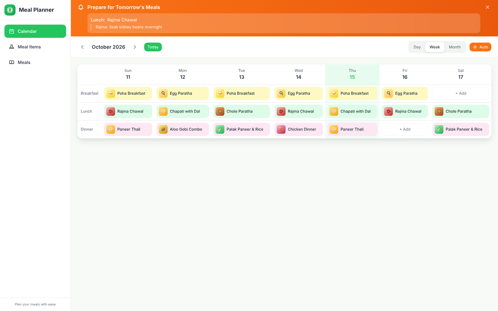
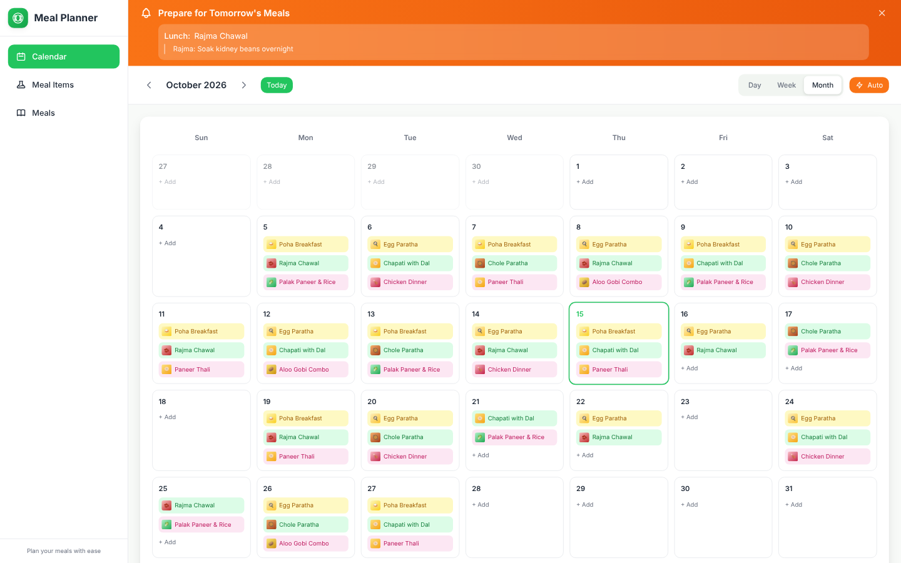
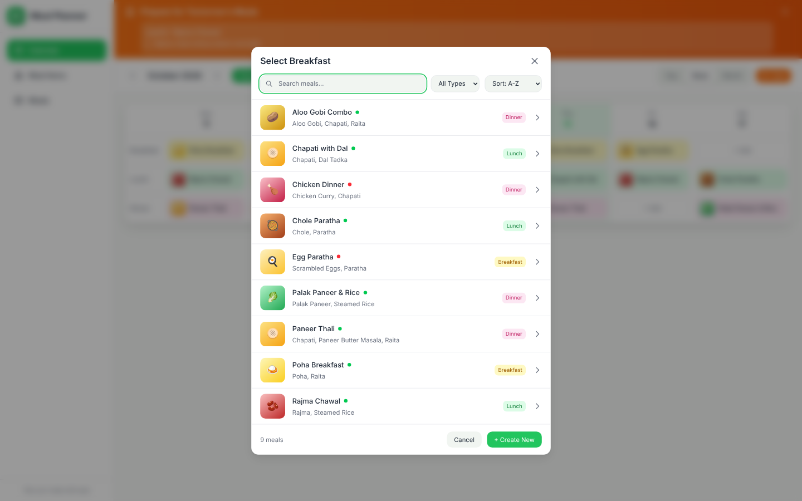
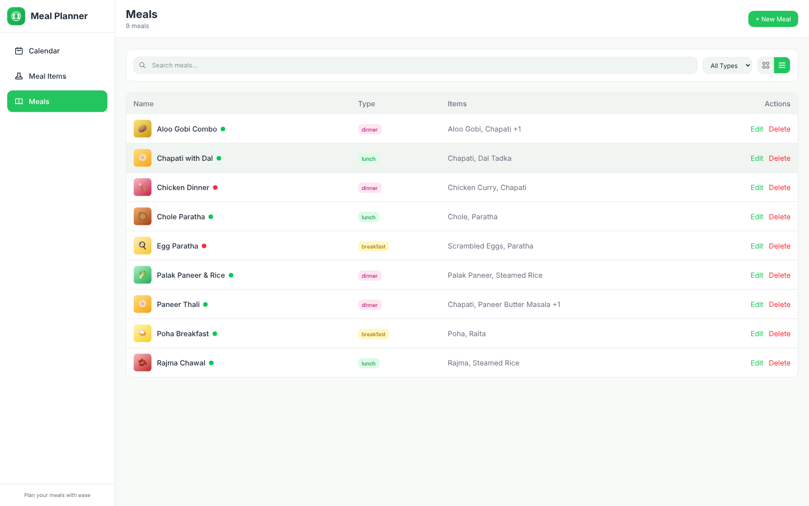
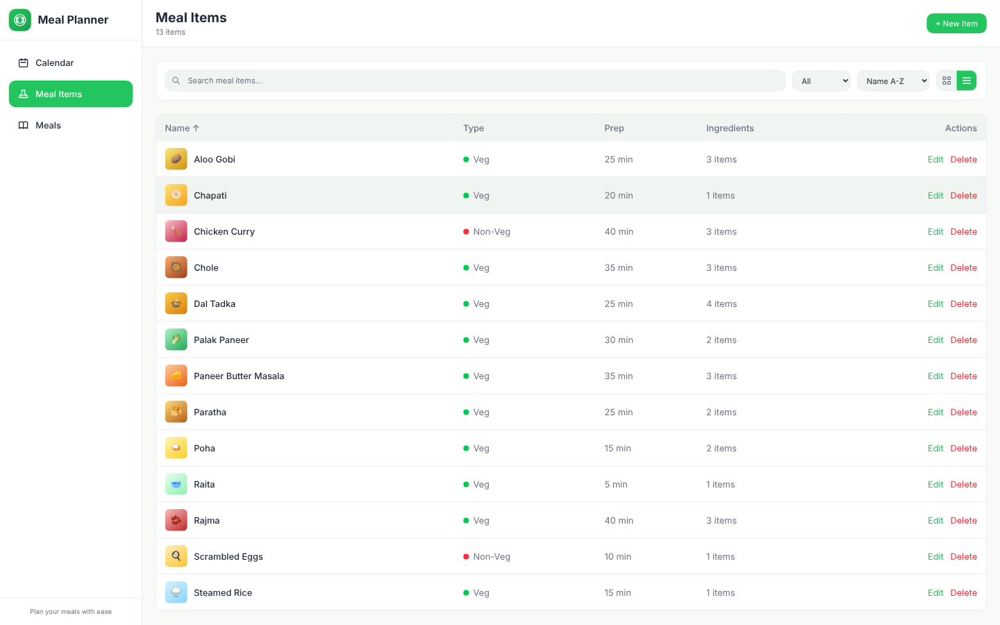
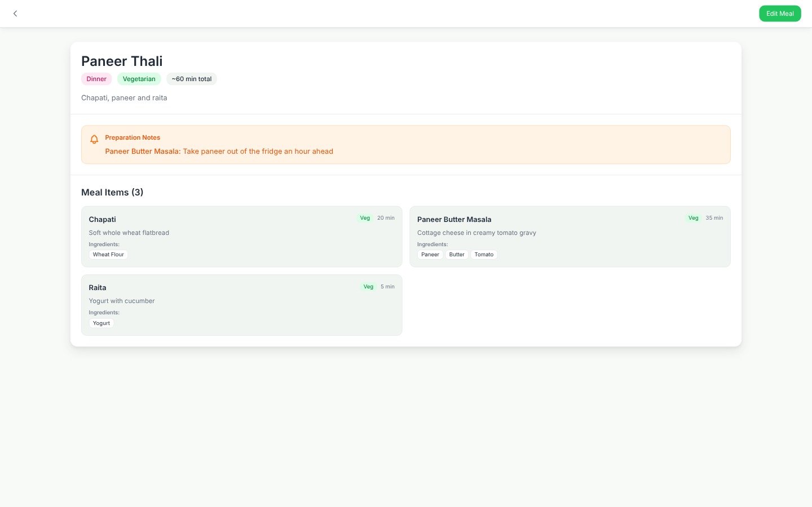
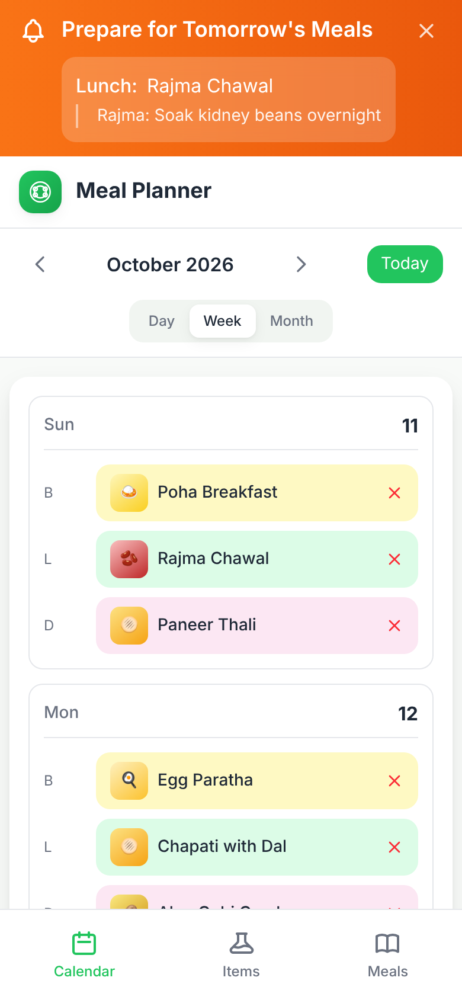
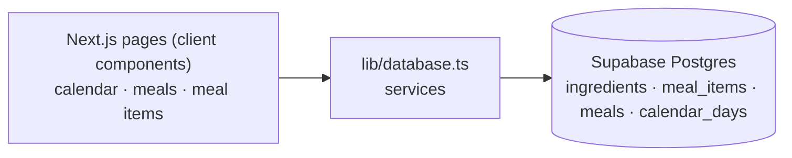

# Meal Planner

**Plan the week's breakfast, lunch and dinner on a calendar, build meals from reusable dishes, and get reminded what to prep tonight.**


[](LICENSE)




## Why I built this

Deciding "what's for dinner" every day, and remembering to soak the beans the night before, is a daily chore. I wanted one place to compose meals from dishes I already cook, drop them on a calendar, and be nudged about prep steps the day before.

## Features

- **Day / week / month calendar** with breakfast, lunch and dinner slots; drag and drop meals between slots
- **Auto-suggest:** fill every empty slot with a random meal of the matching type
- **Prep reminders:** per-dish notes ("Soak kidney beans overnight") surface in a banner for tomorrow's meals
- **Three-level library:** ingredients, then dishes (meal items), then meals (combinations of dishes)
- **Search, filter and sort** in the meal picker and library pages; veg / non-veg indicators; grid and list views
- **Meal detail page** with ingredients, prep times and notes
- **Responsive:** sidebar on desktop, bottom navigation on mobile
- **Runs without credentials** via a bundled mock Supabase server with demo data

## Screenshots

| | |
|---|---|
| <br>Month view | <br>Assigning a meal |
| <br>Meals library | <br>Dishes library |
| <br>Meal detail with prep notes | <br>Mobile |

## Architecture



Details, ER and sequence diagrams: [docs/ARCHITECTURE.md](docs/ARCHITECTURE.md).

## Tech stack

Next.js 16 (App Router, Turbopack) · React 19 · TypeScript · Tailwind CSS 4 · Supabase (`@supabase/supabase-js`) · pnpm

## Quick start

```bash
pnpm install
```

**Zero-setup demo (no accounts, no env vars):**

```bash
pnpm demo
```

This starts a mock Supabase server with fictional data (`scripts/demo/mock-supabase.mjs`) together with the dev server. Data is in memory and resets on restart.

**With your own Supabase project:** run [`supabase-schema.sql`](supabase-schema.sql) in the SQL editor, copy `.env.example` to `.env.local`, fill in the values, then `pnpm dev`. More in [SUPABASE_SETUP.md](SUPABASE_SETUP.md).

Open http://localhost:3000.

## Configuration

| Variable | Required | Description |
|---|---|---|
| `NEXT_PUBLIC_SUPABASE_URL` | yes | Supabase project URL |
| `NEXT_PUBLIC_SUPABASE_ANON_KEY` | yes | Supabase anon (public) key |

## Deployment

Deploy to Vercel (or any Node host): set the two variables above, `pnpm build`, `pnpm start`. The app has no authentication; enable Supabase Auth and row-level security before exposing it publicly.

## Project structure

```
src/app/            pages: calendar (/), /meals, /meals/[id], /meal-items
src/components/     Sidebar, BottomNav, AppBar
src/lib/            supabase client + types, database service layer
supabase-schema.sql schema and sample data
scripts/demo/       mock Supabase server with fictional data
docs/               architecture notes and media
```

## Roadmap

- Authentication and per-user data with row-level security
- Shopping list generated from the week's ingredients
- Timezone-safe date handling
- Tests and a working lint setup
- Drag to reorder and copy a week

## Author

Ashish Agrawal · [github.com/ashish979](https://github.com/ashish979)

Released under the [MIT License](LICENSE).
