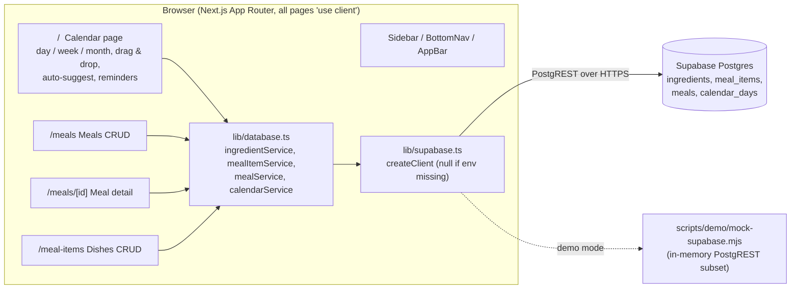
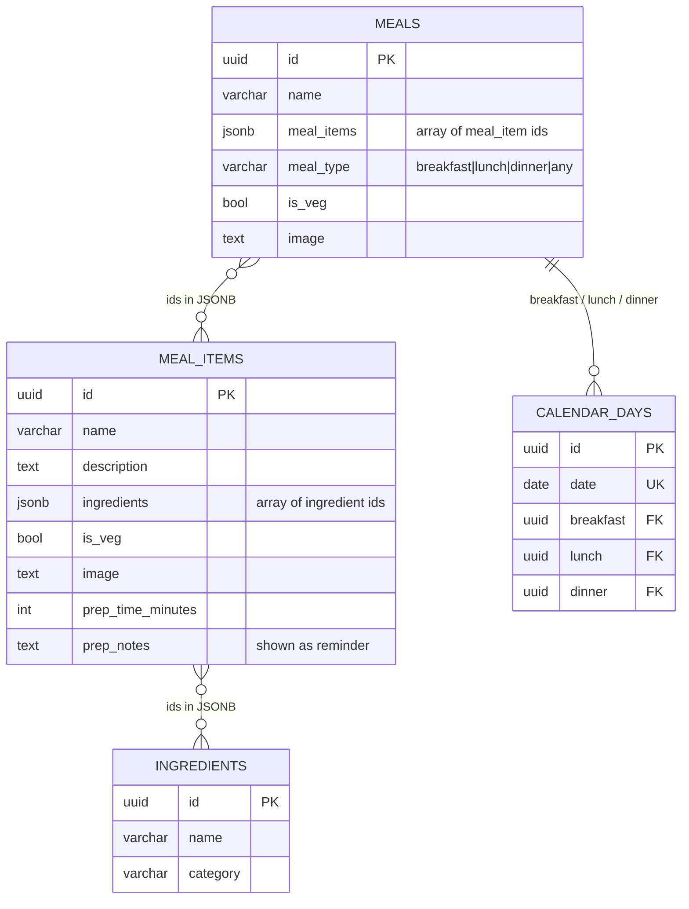
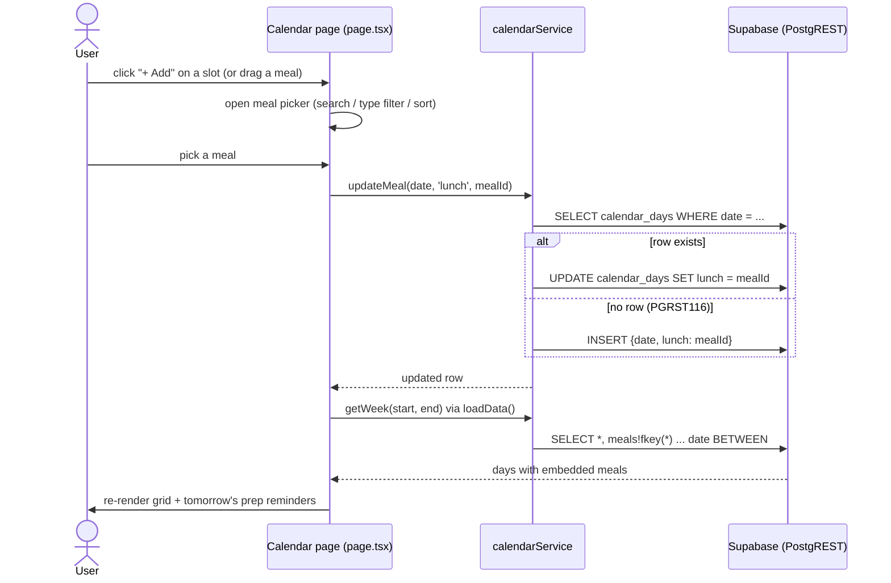

# Architecture

Meal Planner is a client-rendered Next.js (App Router) app that talks directly to Supabase (Postgres) from the browser. There is no custom API layer and no authentication: it is a single-household tool.

## Components

## Data model

Ingredients -> meal items (dishes) -> meals (combinations) -> calendar days (scheduling). Links between the first three levels are JSON arrays of ids, not join tables; only `calendar_days` has real foreign keys (`ON DELETE SET NULL`). `updated_at` is maintained by triggers.

## Main flow: assigning a meal to a day

## Reminders and auto-suggest

- **Reminders:** after each load the page fetches tomorrow's `calendar_days` row, resolves its meals and dishes, and collects every non-empty `prep_notes` into the orange "Prepare for Tomorrow's Meals" banner.
- **Auto-suggest ("Auto"):** for each empty slot in the visible range, picks a random meal whose `meal_type` matches (or is `any`) and writes it via `updateMeal`. Sequential, client-side.

## Auth

None. The browser uses the Supabase anon key against tables with no row-level security configured in `supabase-schema.sql`. Anyone with the URL and key can read and write. For anything beyond personal use, enable Supabase Auth and RLS policies.

## Integrations

Only Supabase (`@supabase/supabase-js`). Images are plain URLs stored in the `image` column; a meal without an image falls back to its first dish's image.

## Configuration

| Variable | Purpose |
|---|---|
| `NEXT_PUBLIC_SUPABASE_URL` | Supabase project URL |
| `NEXT_PUBLIC_SUPABASE_ANON_KEY` | Supabase anon (public) key |

If either is missing, `supabase` is `null` and every service call throws "Supabase is not configured", which the pages show as an error state.

## Deployment

Standard Next.js: `pnpm build && pnpm start`, or deploy to Vercel with the two env vars set. Run `supabase-schema.sql` once in the Supabase SQL editor (note: it drops and recreates the tables).

## Key design decisions

- **No backend layer:** one small `database.ts` service module keeps data access in one place and keeps the app deployable as a static-ish frontend plus managed Postgres.
- **JSONB id arrays instead of join tables:** simpler CRUD and ordering for small data; trade-off is no referential integrity between ingredients/dishes/meals.
- **Three-level composition:** reusable dishes and meals mean a weekly plan is just picking meals.
- **Env-guarded client:** the app builds and renders without credentials and fails with a readable error.
- **Mock PostgREST for demos/tests:** `scripts/demo/mock-supabase.mjs` implements only the query shapes this app uses.
